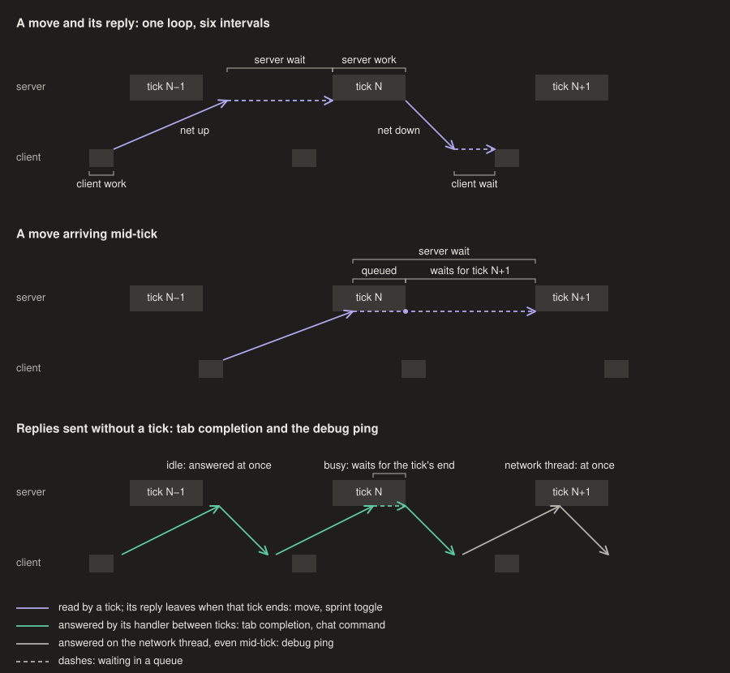
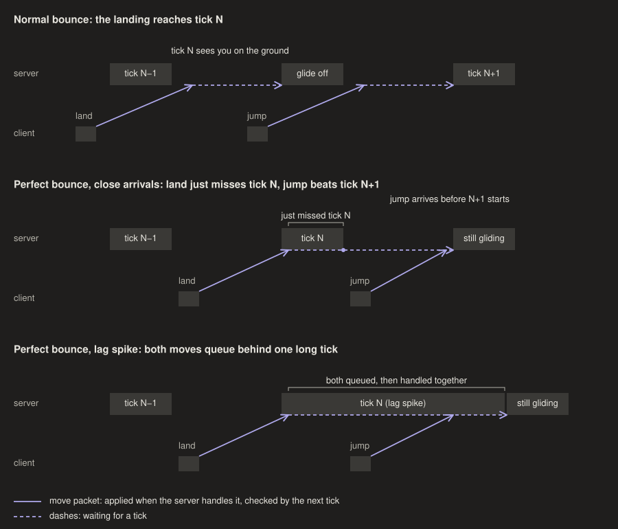

# elytra-tas

Replay a recorded course run on EMC from a Flashback recording, in a loop.

```
python3 extract_run.py REPLAY.zip --list                 # completed runs in a replay
python3 extract_run.py REPLAY.zip -o tas/NAME.tas        # last completed run -> tape
\tas_play NAME runs=1 trace                              # in game, on deftenvy
```

Flashback replays live in `<profile>/flashback/replays/`. `tas_play.pyj` and `tas/`
are symlinked into `<profile>/minescript/`; logs go to `minescript/tas_logs/`.

- `flashback.py`: Flashback replay reader (chunk/action format, local player poses,
  chat/title text, shared flags, held slot)
- `extract_run.py`: finds runs, reconstructs per-tick inputs, writes a `.tas` tape and
  checks every gliding tick against elytra physics
- `physics.py`: MC 26.2 elytra physics, float-faithful, for that check (needs numpy)
- `tas_play.pyj`: Minescript (Pyjinn) player
- `pyjinn_check.sh FILE.pyj...`: compiles `.pyj` files with the Pyjinn inside the
  installed Minescript mod, as `\script` does. Run it after every edit. why? Pyjinn
  accepts less than Python (e.g. `S["a"], S["b"] = 1, 2` is rejected: only plain
  names in tuple targets), CPython's `ast` passes those, and in game you see only
  the first error per launch. It catches syntax only, not runtime errors.
- `mod/`: Fabric client mod, see below. `netlog.py`: reader for its logs; its
  docstring is the format spec (`python3 netlog.py LOG.tsv.gz --timeline`).

## Network/tick logger (`mod/`)

Logs what Flashback can't: exact client tick poses and keys, key presses and releases
between ticks, every outbound packet,
inbound packet decode and handle times, socket read/write times, and in singleplayer
the integrated server's view (move packets processed, player ticks, glide ends). One
gzipped TSV per connection in `<profile>/elytra-tas/logs/`. It starts on joining a
server or world (config via Mod Menu, YACL), or with an unbound toggle key. It only
observes, apart from the pings below, so it may run on `lqmbda` too.

```
cd mod && ./gradlew build
cp build/libs/elytra-tas-0.2.0.jar "$HOME/Library/Application Support/ModrinthApp/profiles/main/mods/"
```

Rename the previous version's jar in `mods/` to `.disabled`, as with emc-replay, and
restart Minecraft.

- **"On the wire" means the end of Netty's pipeline, not the network.** `W` is when a
  packet's final frame (compressed, encrypted) reaches the handler next to the socket;
  the `F` flush around it ends when the socket write returned, i.e. the bytes are in
  the kernel's send buffer. `R` is Netty's socket read. Kernel and network delay are
  not visible.
- **Mixins use `defaultRequire: 1`, so a broken injection crashes at launch.** why? a
  missing hook would otherwise give a log with silent holes. To check injections
  without launching the client, copy `mod/` to a scratch dir, move the mixin list from
  `client` to `mixins`, set `environment` to `*`, add a `main` entrypoint that calls
  `MixinEnvironment.getCurrentEnvironment().audit()` and halts, and `./gradlew
  runServer` (with `run/eula.txt`). `-Dmixin.debug.export=true` writes the mixed
  classes to `run/.mixin.out/`. This worked for 0.1.0 (2026-10-20 01:19 EDT).

## Tick phase (`/etas phase`)



A client command in the same mod, on whether the logger runs or not. It splits the loop
from a client tick through a move, the server's reply and the next client tick that sees
it into round trip, server wait, server work (what servers call MSPT), client wait and
client work, which add up to a whole number of ticks; plus the tick interval. `/etas
phase help` explains each row. The figures come from `python3 docs/figures.py`.

- **Server wait and server work come from probes.** The mod sends a tab-completion
  request for `/etas` 4 times a second at random times. The vanilla server answers them on
  its main thread between ticks, so a probe arriving mid-tick waits for the tick to end.
  Against send phase that extra delay is a sawtooth, and fitting it gives the tick start
  and the work time W. In simulation (±2–4 ms jitter, 40 probes) the fit lands within
  ~1.5 ms of the tick start and rejects W ≤ 5 ms, so a nearly idle server shows nothing.
  A proxy or plugin that answers completions off the main thread shows no jump either.
  Not yet seen on a real server as of 2026-10-29 16:30.
- **Every reply leaves at the end of its tick.** 26.2's `MinecraftServer.tickChildren`
  suspends flushing for every player and flushes once after all levels and players have
  ticked. So `set_health` minus your move's send time minus the round trip is server wait
  + server work, not the wait alone; the readout falls back to that sum when the probes
  find no jump. In the 20:33 log of 2026-10-28, 7 of 8 kept bounces sat at a sum of
  15–21 ms and the 8th at 39 next to a stall: the perfect-bounce edge is the tick start,
  so that sum there is W.
- **Client wait and tick interval need a packet the server sends every tick.** They time
  `ClientboundSetHealthPacket`, which vanilla sends from `ServerPlayer.doTick` only when
  health or food changed. EMC sends it every tick (2026-10-28). Without it, client wait
  is derived from the loop (marked so) and the loop check is skipped.
- **The mod sends its own pings, 4 a second, while connected.** why? vanilla pings only
  with the F3 network chart open, and the vanilla server answers
  `ServerboundPingRequestPacket` on the Netty thread, not at a tick, so it gives a clean
  round trip (63–71 ms on EMC, 2026-10-28 20:33).
- **The client tick grid is fixed for the whole process.** `DeltaTracker.Timer` keeps a
  fractional residual and drops extra catch-up ticks rather than resetting, so a hitch
  or a relog doesn't move it; a game restart does. The tracker reads the grid from the
  timer. why? tick starts trail the grid by up to a frame (0–10 ms at ~100 fps), which
  would otherwise show up as phase noise.

## Things that will bite

- **Flashback wraps yaw.** `Recorder.Position` stores `Mth.wrapDegrees(yaw)`; the
  client's yaw is unbounded, and elytra physics sees its float bits through a sine
  table, so 179.27 and -180.73 don't fly the same (~1e-5 blocks/tick). The extractor
  unwraps from the reset teleport's absolute yaw. why? without it the replay drifts
  off the recording within a few hundred ticks.
- **Don't use Minescript's `player_set_orientation` / `player_press_*` for playback.**
  The first applies `% 360` to yaw (same bit problem); the second defers through
  `set_timeout` to a render frame, so key changes can land a tick late. The player sets
  `Entity.setYRot/setXRot` and swaps `player.input` for a plain `ClientInput`. why?
  playback is open loop, so a one-tick slip or a changed float desyncs the run.
- **Flashback doesn't record keys or server teleports.** Inputs are fitted from the
  trajectory; teleports show up as pose jumps (`ClientboundPlayerPositionPacket` is in
  Flashback's ignored set).
- **A swapped-in `ClientInput` sees jump presses a tick early.** `LocalPlayer.aiStep`
  reads `wasJumping` from `input.keyPresses` before `input.tick()`, which in vanilla
  loads the new keys; a plain `ClientInput` has an empty `tick()`, so a jump set between
  ticks is never an edge and the glide never starts. The player schedules presses
  through `autoJumpTime` (vanilla then calls `makeJump()` after `tick()`). why? the
  elytra start is a jump edge in air.
- **Pyjinn can't assign fields of Java objects** (`player.input = x` fails at runtime,
  even for public fields); use `getField`/`getDeclaredField` + `Field.set`.
- **The local player's camera reads the live rotation, without interpolation**
  (`LocalPlayer.getViewYRot`), so setting rotation once per tick looks 20 Hz.
  `tas_play.pyj` sets the exact tape value in the tick handler and lerps only after
  physics (`END_CLIENT_TICK`, render events). why? physics and the server must only
  ever see tape values; a display value set in the tick handler gets flown (it did:
  0.5 blocks off by tick 56). All render events (Minescript's and Fabric's) fire after
  camera setup, so a value set in one shows up a frame later.
- **Pyjinn can implement Java interfaces** (`StartTick(fn)` makes a proxy), which
  reaches Fabric events Minescript doesn't wrap. Fabric listeners can't be removed;
  after exit Pyjinn no-ops them. An exception in one propagates into the game loop
  and crashes it, so catch everything and only set flags there.
- **Minescript's `chat` event misses server system messages** (Minescript 5.0b11, MC
  26.2): it hooks `ChatComponent.addClientSystemMessage`/`addPlayerMessage`, but server
  messages like EMC's "Course complete!" come through `addServerSystemMessage`.
  `tas_play.pyj` polls `ChatComponent.allMessages` instead. why? with the event, a
  completed lap was logged as "tape ended without completing".
- **Pyjinn's `range()` can't count down**: `range(n, -1, -1)` is empty (its iterator
  only tests `pos < stop`). Pyjinn 0.14.
- **Pyjinn floats are `Double`**, narrowed to `float` for method arguments but not
  constructor arguments: `Vec2(1.0, 0.0)` throws ClassCastException; use
  `Vec2(JavaFloat(x), JavaFloat(y))`.
- **Tick order (MC 26.2, Fabric API 0.160):** `START_CLIENT_TICK` → keybinds →
  Minescript's `tick` event (Fabric `START_LEVEL_TICK`, head of `tickEntities`) →
  player physics → `END_CLIENT_TICK`; then per frame: mouse turn → camera → render.
  Inputs set in the tick handler are used by the physics right after it, in the same
  tick. A pose Flashback records at tick N used the rotation recorded at N. why? the
  player is open loop, so anything set between the handler and physics is what flies.
- Gliding is client-side physics, keys are ignored, and only the server ends a glide
  (`LivingEntity.updateFallFlying` is server-only). An ebounce keeps the glide ("perfect")
  only if the server handles the landing move (onGround=1) and the jump move (onGround=0)
  with no player `doTick` between them; the server handles packets on arrival and checks
  onGround once per tick. With steady 50 ms ticks on both ends that almost never happens:
  on EMC all 5 perfect bounces in 312 landings (logs of 2026-10-20 01:41–02:06) fell in or
  beside server lag spikes (ticks of 91–725 ms), and the one singleplayer one in a client hitch that sent the two
  moves 27 ms apart. So the extractor refuses runs whose glide ends before the finish.
  The Burrowed Grove run (2026-10-19 replay) has none.

  
- Packet IDs in `flashback.py` are for protocol 776 (MC 26.2), read off `GameProtocols`
  in the client jar; a different protocol is rejected at load.

## EMC course rules (measured)

From the logger, 2026-10-20 01:41–02:06 (EMC, ~80–110 ms RTT). The server acts once
per tick, and its tick phase against the client's holds within ~5 ms over a 25-minute
session (it wanders up to ~30 ms over hours: overnight log of 2026-10-20 02:50–08:50), so a
response to a packet arrives in one of two delay bands one tick apart (about 120 and
170 ms after the send here). Fit regions with that in mind: a fixed-width delay window
gives false contradictions.

- **An unfocused client runs ticks in pairs.** At the 10 fps background/inactivity
  limit, two ticks run in each frame about 1 ms apart, then nothing for ~100 ms, so the
  moves go out in pairs too. Server timing results from such a run don't carry over to
  focused play. why? the overnight 2026-10-20 log ran like this after its first minute.

- **Boosters** set velocity to `speed × look`, where look is the rotation the server
  last received (sent ~165–180 ms before the velocity arrives), and re-send it every
  tick you are inside, so turning inside a ring steers. Alpine: 1.4 and 2.5 b/t; no
  axis reached the ±3.9 clamp there. Ring frames are solid blocks. Standing on the second
  alpine booster's gold blocks without gliding did not kill you for up to 8.7 s, so the
  kill rule seems to exempt booster volumes (at least one other booster does the same).
- **Hard wall hits overwrite your velocity, ~3 ticks late (vanilla).** The server runs
  its own copy of your elytra physics; when it loses > 0.3 b/t of horizontal speed in a
  collision, `LivingEntity.handleFallFlyingCollisions` deals fly-into-wall damage,
  `markHurt()` follows, and `ServerEntity` sends the server's velocity to you as if it
  were knockback. The client applies it on arrival, so with ping it replaces the
  velocity of a later tick. Alpine log: 24 of 36 such hits echoed (the misses fit the
  10-tick damage cooldown), 4 of 21 smaller ones. A physics replay has to apply it.
- **Timer** is wall-clock time between the "Timer started!" and "Course complete!"
  server ticks, rounded to 0.02 s: five identical 647-tick runs gave 32.34 or 32.36
  depending on whether that interval was under or over 32.35 s.
- **Start area** is box-like in bulk (canyon x < −266, 168 ≤ y < 177–178, z ≥ 164;
  super classic downtown −52 ≤ x < −27, 86 ≤ y < 99, z < −64) but not one box: near
  canyon's z ≈ 195–199 corner the −x face sits near −265.2, and landing at y = 167
  started the timer after 300 ms airborne below 168 did not. Leaving it without gliding
  starts the timer and kills you in the same tick.
- **Canyon finish** is no single box, sphere or cylinder under any delay; probably a
  union of boxes.
