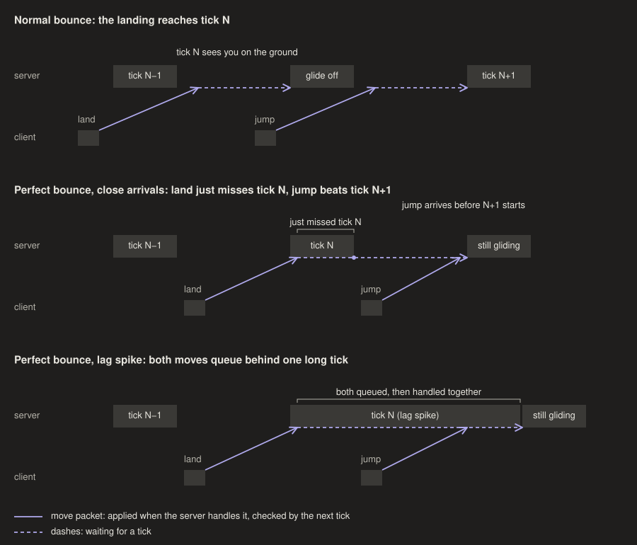

# Ebounces: when a bounce keeps the glide

Gliding is client-side physics, keys are ignored, and only the server ends a glide
(`LivingEntity.updateFallFlying` is server-only). An ebounce keeps the glide ("perfect")
only if the server handles the landing move (onGround=1) and the jump move (onGround=0)
with no player `doTick` between them; the server handles packets between ticks and checks
onGround once per tick. But while it is behind schedule it runs a queued packet only once
the packet is over 3 ticks old (26.2 `MinecraftServer.shouldRun`), so after a long tick
the moves pile up and are handled together. Without lag both moves have to arrive in
one tick's gap: the landing just after a tick start (server wait just under 50 ms) and
the jump less than that later. Client ticks run at frame starts, so the two moves leave
up to a frame less than 50 ms apart. In the 2026-10-29 17:05 log, at server wait
~47 ms (set by a 68 ms outbound hold, see [tick-phase.md](tick-phase.md)), 9 of 148 bounces kept the glide,
8 of them with a flat round trip: 7 of the 53 whose moves left 45–48 ms apart, against
2 of the 97 at 49 ms or more. At server wait ~29 (17:17 log) none of 246 did. Every other perfect bounce
so far came with lag:
on EMC all 5 perfect bounces in 312 landings (logs of 2026-10-20 01:41–02:06) fell in or
beside server lag spikes (ticks of 91–725 ms), and the one singleplayer one in a client hitch that sent the two
moves 27 ms apart. In the 2026-10-29 16:32 log, 6 of 9 kept glides in 132 bounces came
during two freezes of the whole server (3.2 and 2.5 s: no set_health and no pongs), and
the other 3 next to `set_health` gaps of 100–140 ms. Their landings' server waits
(37–42 ms) were the same as the other bounces'. So most recorded runs lose the glide
somewhere; the extractor writes the server's glide-offs into the tape as `@server`
lines, and `etas verify` replays them.

