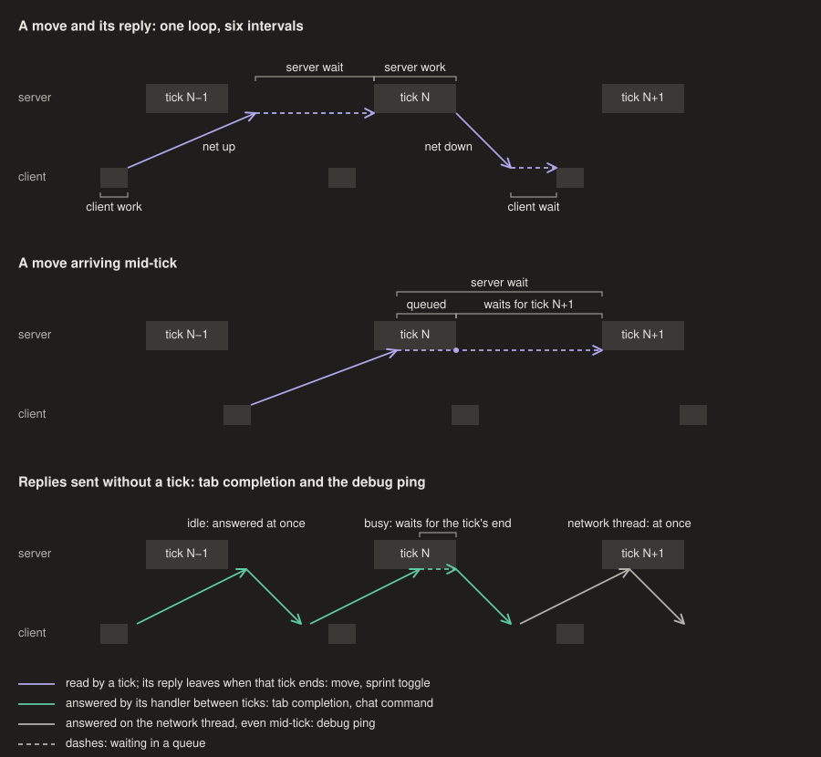

# Tick phase (`/etas phase`)

A client command in `mod/`, on whether the logger runs or not. It splits the loop
from a client tick through a move, the server's reply and the next client tick that sees
it, in the order it happens, into net up + down (the round trip; the client can't split
it), server wait, server work (MSPT), client wait and client work, which add up to a
whole number of ticks. A second section has what `set_health` alone gives: server wait +
work, and the tick interval. `/etas phase help` explains each row. The figures come from
`python3 docs/figures.py`.

- **Server wait and server work come from probes.** The mod sends a tab-completion
  request 4 times a second at random times, for `/msg `, `/tell `, `/help ` or `/` in
  turn until one gets replies, then only that one. why not something with no
  suggestions? EMC sent no reply to any of 1113 requests for `/etas` (2026-10-29
  16:02–16:08 logs), though the vanilla server replies even when empty. The vanilla
  server answers them on its main thread between ticks, so a probe arriving mid-tick
  waits for the tick to end.
  Against send phase that extra delay is a sawtooth, and fitting it gives the tick start
  and the work time W. The fit takes at least the last 20 s and follows the sawtooth's
  lower edge. why? on EMC about 30% of replies (pongs too) came 10–90 ms late, in clumps
  with other downstream packets (`set_health` spacing p10 9 ms, p90 78 ms in the
  2026-10-29 16:16 log, against ±4 ms on 10-28), and a symmetric fit failed on most 10 s
  windows of that log. The lower-edge fit found the edge in all 89 sliding 20 s windows
  (start 24–30 ms, W 17–26 ms). It needs W ≥ 8 ms; a proxy or plugin that answers
  completions off the main thread shows no jump at all.
- **EMC's timer chat waits for tick work too, so don't assume a move is handled on arrival.**
  At 2026-11-06 01:15 EST, moves 4.6 ms before the flush got chats 6.1 ms late, and moves 21 ms before it
  got 1.9 ms ([emc-course-rules.md](emc-course-rules.md)). `tools/tick_wait.py` measures it. Reading
  phase from a log also needs a steady ping: it went from 62 to about 150 ms at 00:57 EST that
  night with no spoof on, was still high after a laptop restart, and drained by 01:10, cause unknown.
- **Every reply leaves at the end of its tick.** 26.2's `MinecraftServer.tickChildren`
  suspends flushing for every player and flushes once after all levels and players have
  ticked. So `set_health` minus your move's send time minus the round trip is server wait
  + server work, not the wait alone; the readout falls back to that sum when the probes
  find no jump. In the 20:33 log of 2026-10-28, 7 of 8 kept bounces sat at a sum of
  15–21 ms and the 8th at 39 next to a stall: the perfect-bounce edge is the tick start,
  so that sum there is W.
- **Client wait and tick interval need a packet the server sends every tick.** They time
  `ClientboundSetHealthPacket`, which vanilla sends from `ServerPlayer.doTick` only when
  health or food changed. EMC sends it every tick (2026-10-28). Without it, client wait
  is derived from the loop (marked so) and the loop check is skipped.
- **The mod sends its own pings, 4 a second, while whitelisted.** why? vanilla pings only
  with the F3 network chart open, and the vanilla server answers
  `ServerboundPingRequestPacket` on the Netty thread, not at a tick, so it gives a clean
  round trip (63–71 ms on EMC, 2026-10-28 20:33).
- **The client tick grid is fixed for the whole process.** `DeltaTracker.Timer` keeps a
  fractional residual and drops extra catch-up ticks rather than resetting, so a hitch
  or a relog doesn't move it; a game restart does, and so do the buttons in Mod Menu →
  Tick phase. Those work only while not in a world (a server could see the phase move
  within a session) and only delay ticks (-1 ms is a 49 ms delay), so ticks never come
  closer than 50 ms. The tracker reads the grid from the
  timer. why? tick starts trail the grid by up to a frame (0–10 ms at ~100 fps), which
  would otherwise show up as phase noise.
- **Keep client wait and server wait away from 0/50.** A packet that arrives within a few
  ms of a tick edge is read on either side of it, so the glide-off reaches the client a
  tick early or late at random. In the 2026-10-29 17:05 log, at client wait ~0 the
  client first saw it 3 ticks after landing 112 times and 4 ticks 86 times, decided on
  the client (handled a median 0.2 ms before a tick, or 9 ms after one). A redeploy press
  came before the glide-off in 22% of the 3-tick bounces and 44% of the 4-tick ones.
  At client wait ~32 that split went away, but server wait ~47 then read 29 of 148
  landings a tick early. Server wait just under 50 is also where perfect bounces happen
  without lag (see [ebounces.md](ebounces.md)).
- **A packet-delay mod moves the waits, but only its hold mod 50 helps.** Ping Equalizer
  held moves ~68 ms and replies ~71 ms (2026-10-29 17:05 and 17:17 logs). The holds sit
  between the logger's send and wire records and between decode and handle, so net up +
  down leaves them out, while server wait and client wait include them: they dropped by
  18 and ~21 ms, as the loop says. The whole ticks of a hold are pure cost: the glide-off
  reached the client 6–7 ticks after landing instead of 3–4. The phase buttons cost
  nothing but move the two waits only against each other (client wait +d, server wait
  −d); their sum mod 50 is set by the round trip, the work on both ends and any hold.
